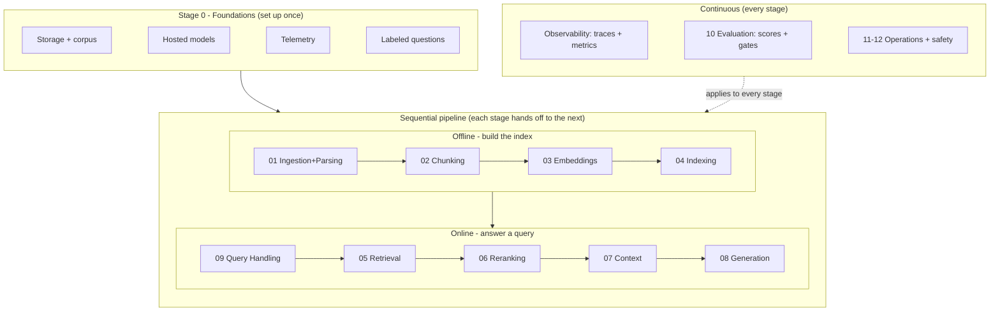

# RAG-from-Scratch-to-Advance

A zero-to-production guide: build a RAG system, see what happens at every stage, and improve it using measured evidence.

## The Project: Shakespeare Evidence Desk

Build a **literature research assistant and reusable LLM grounding service** over ten complete Shakespeare plays. Retrieve passages across works, answer questions about characters and events, and support literary interpretations with quoted evidence rather than invented quotations.

Ask: **"How do encounters with ghosts influence Hamlet and Macbeth? Compare their reactions with passages from both plays."**

The assistant distinguishes explicit textual facts from interpretations and admits when the corpus does not support an answer. Citations identify the work and source edition, with act/scene, speaker, and passage locations where reliably extracted. Do not invent canonical line numbers or imply that one interpretation is the only correct reading.

The same retrieval pipeline exposes a `retrieve_evidence` tool for other LLM applications. Its response contains passages, source locations, document versions, retrieval scores, and a request ID. Scores indicate relevance, not guaranteed truth. A small dashboard shows current metrics for the selected pipeline stage.

**Final deliverables:** a grounded assistant, a reusable grounding API/tool, a stage-by-stage dashboard, and a tested, deployable service with evaluation gates and operational monitoring.

## Starting Corpus

Ten Project Gutenberg text editions are uploaded to a private Azure container. Subscription, principal, resource group, location, storage account, container, and selected snapshot are configured only in the ignored [.env](.env). The shareable [.env.example](.env.example) contains placeholders, not personal Azure identifiers.

| Work | Source |
| --- | --- |
| Hamlet | [Project Gutenberg 1524](https://www.gutenberg.org/ebooks/1524) |
| Macbeth | [Project Gutenberg 1533](https://www.gutenberg.org/ebooks/1533) |
| Romeo and Juliet | [Project Gutenberg 1513](https://www.gutenberg.org/ebooks/1513) |
| Othello | [Project Gutenberg 1531](https://www.gutenberg.org/ebooks/1531) |
| King Lear | [Project Gutenberg 1532](https://www.gutenberg.org/ebooks/1532) |
| A Midsummer Night's Dream | [Project Gutenberg 1514](https://www.gutenberg.org/ebooks/1514) |
| The Merchant of Venice | [Project Gutenberg 1515](https://www.gutenberg.org/ebooks/1515) |
| Julius Caesar | [Project Gutenberg 1522](https://www.gutenberg.org/ebooks/1522) |
| The Tempest | [Project Gutenberg 1540](https://www.gutenberg.org/ebooks/1540) |
| Twelfth Night | [Project Gutenberg 1526](https://www.gutenberg.org/ebooks/1526) |

The selected snapshot is `AZURE_CORPUS_PREFIX` in [.env](.env). Its manifest records source URLs, titles, download time, file sizes, and SHA-256 checksums. The ten raw texts retain their original Project Gutenberg notices. Original Shakespeare works are public domain; check edition terms and applicable local law before redistributing the downloads.

[scripts/upload_shakespeare.sh](scripts/upload_shakespeare.sh) loads the same [.env](.env), creates a fresh snapshot using Azure CLI identity authentication, validates each title/author, checks the uploaded blob count, and verifies a Hamlet download against its source. It requires `az`, `curl`, `jq`, and `shasum`, an existing container, and Storage Blob Data Contributor access. It writes an ignored structured upload result; the notebook uses that result to select the new snapshot in [.env](.env).

```bash
bash scripts/upload_shakespeare.sh
```

Evaluate exact quotations, character/event lookups, paraphrases, cross-play comparisons, ambiguous names, and questions not answered by these works. Label supporting passages and acceptable interpretations rather than insisting on one reference answer. Keep Gutenberg administrative notices out of retrieval experiments while preserving the unchanged raw files.

The initial corpus is text-only. A multimodal model can still process text, but visual understanding cannot be evaluated meaningfully without visual sources. Add openly licensed scanned or illustrated editions later as a separate experiment; do not fabricate images or treat rendered text as evidence of visual-reasoning quality.

## Run the First Notebook

Open [experiments/00-Foundations-and-Setup.ipynb](experiments/00-Foundations-and-Setup.ipynb). It covers configuration, storage creation/reuse, permission diagnosis/repair, private container creation, corpus upload/reuse, checksum validation, setup handoff export, hosted model connections, a grounding demo, telemetry, and labeled evaluation questions.

1. Configure the ignored [.env](.env) using [.env.example](.env.example) as the template. Keep this trusted local file shell-compatible; both the notebook and uploader use it. Never commit it or share resource-identifying notebook outputs.
2. Use a local virtual environment and install [requirements.txt](requirements.txt). Select that environment as the notebook kernel.
3. Authenticate with Azure CLI using `az login` for the target tenant. Every notebook operation explicitly uses `AZURE_SUBSCRIPTION_ID`; it does not change the global default subscription.
4. Run cells in order. Defaults inspect the existing setup without cloud writes. They write an ignored local setup handoff for the next stage.
5. For a fresh setup, explicitly enable `CREATE_INFRASTRUCTURE`, `GRANT_DATA_ACCESS` if authorized, and `UPLOAD_NEW_CORPUS`. Role propagation can require rerunning the data-access check later. Azure handoff upload has its own `UPLOAD_SETUP_HANDOFF` switch.

```bash
python3 -m venv .venv
source .venv/bin/activate
python -m pip install -r requirements.txt
```

The notebook updates `AZURE_CORPUS_PREFIX` after an enabled upload. Its local setup handoff and upload result are generated under the ignored artifact directory. A standalone uploader run creates a new snapshot but does not automatically change the selected prefix: review its result and update private configuration deliberately. Clear notebook outputs before committing. Account-key and anonymous-access workarounds are not needed for the portal permission error; use the scoped blob data role and verify effective access.

## Repository Structure

Exploration and the deployable result are kept in separate folders. Notebooks are where we experiment; the Python package is the final, importable outcome exposed as an API.

```
experiments/      # one notebook per stage: explore, measure, select, justify
production/       # final selected implementation for each stage, importable
  settings.py     #   shared config loaded from the same .env the notebooks use
  clients.py      #   keyless Azure OpenAI client (Entra identity)
  ingestion/      #   stage 01: loaders, preprocess, parser, pipeline
  chunking/       #   stage 02
  embeddings/     #   stage 03
  indexing/       #   stage 04: vector_store, indexer
  retrieval/      #   stages 05-07: retriever, hybrid_search, reranker, context_builder, query_processor
  generation/     #   stage 08
  evaluation/     #   stage 10: dataset, metrics
  api/            #   stage 11: FastAPI app and routes
  tools/          #   retrieve_evidence tool and MCP server
  pipeline.py     #   composes the stages into offline + online flows
.artifacts/       # ignored: handoffs, corpus cache, parsed blocks (local only)
```

Each `production/` module holds the choice justified in the matching `experiments/` notebook. The skeleton exists now and is filled in gradually as each stage is selected; modules raise `NotImplementedError` until their stage is complete. Both the notebooks and the package read the same [.env](.env) through `production/settings.py`, so they never drift. The corpus is not committed: it lives in blobs and caches to the ignored `.artifacts/`, so a tracked `data/` folder is not needed.

## One Notebook per Stage

**Split by experiment axis, not by technique.** A stage gets its own notebook when it has an independently tunable axis and produces a clean frozen handoff the next stage consumes. Techniques (for example, fixed vs. semantic chunking) stay as *sections within* that notebook. Pure setup or engineering with nothing to measure stays grouped (Stage 0 Foundations).

This is why the sequence below splits previously clubbed topics: embeddings (model, dimensions) are tuned independently of indexing (index type, ANN params, schema); reranking is independent of context building; query handling is independent of adaptive routing. Keeping them apart lets each stage be frozen while the next is explored.

Each stage ends with a **measured, justified selection**. The next notebook loads that selection and its artifacts, keeping previous choices fixed. Never silently mix old chunks, new embeddings, or incompatible indexes; each split stage must declare exactly which upstream artifact and version it consumes.

### Stage Map

The pipeline is **sequential**; foundations, observability, evaluation, and operations are **continuous** concerns that wrap every stage.



| Kind | Stages |
| --- | --- |
| **Sequential (the spine)** | 01 Ingestion & Parsing, 02 Chunking, 03 Embeddings, 04 Indexing, 05 Retrieval, 06 Reranking, 07 Context, 08 Generation, 09 Query Handling |
| **Continuous (wraps all stages)** | 00 Foundations, Observability (traces + metrics), 10 Evaluation, 11 Production & Serving, 12 Operations & Safety, dashboard |

## Learning Sequence

Each stage is one notebook under `experiments/` and one module group under `production/`. Done stages link to the notebook; planned stages show the path to be created.

| Stage / Notebook | Experiment Axis (techniques to compare) | Metrics and Selection | Production module |
| --- | --- | --- | --- |
| [00 Foundations](experiments/00-Foundations-and-Setup.ipynb) *(done)* | Not a tunable stage: storage/corpus setup, hosted model connections, grounding demo, telemetry, labeled questions. | Account security, blob access, manifest inventory, checksum; connectivity; trace + log; question schema. | `settings.py`, `clients.py` |
| [01 Ingestion & Parsing](experiments/01-Ingestion-and-Parsing.ipynb) *(done)* | Deterministic rules vs. model-assisted structuring of acts/scenes/speakers; isolate Gutenberg notices. | Line coverage, speaker agreement, dropped/invented lines, latency, cost. Fallback routing by coverage. | `ingestion/` |
| `02 Chunking` | Fixed-size, overlapping, scene/speech-aware, model-assisted semantic chunks. | Token distribution, duplicated context, dialogue continuity, boundary failures, cost. | `chunking/` |
| `03 Embeddings` | Embedding model, vector dimensions, normalization, batching, caching. | Neighbor relevance, usage/latency/cost, failures. Record deployment + dimensions. | `embeddings/` |
| `04 Indexing` | Index type, ANN parameters (M, efConstruction), metadata schema, hybrid config (Azure AI Search). | Index size, build duration, indexed recall vs. exact search. Record schema. | `indexing/` |
| `05 Retrieval` | Keyword/BM25, dense, hybrid with reciprocal rank fusion; top-k, filters, authorization. | Recall@k, MRR, empty-result rate, filter correctness, p95 latency. | `retrieval/retriever.py`, `hybrid_search.py` |
| `06 Reranking` | No reranking, semantic ranking, bounded LLM reranking (candidates fixed). | nDCG@k, evidence coverage, reranker latency, cost. Keep a step only if it helps. | `retrieval/reranker.py` |
| `07 Context Building` | Deduplication, parent context, token budget, citation assembly. | Evidence coverage, context noise, token usage. | `retrieval/context_builder.py` |
| `08 Grounded Generation` | Grounding prompts, exact quotations, citation formats, structured answers, abstention. | Quote fidelity, correctness, claim support, citation validity, abstention errors. Save baseline. | `generation/` |
| `09 Query Handling & Adaptive RAG` | Unchanged vs. rewriting, decomposition, multi-query, follow-up resolution, bounded retries. | Query drift, retrieval gains, multi-hop correctness, unnecessary abstention, tool calls. | `retrieval/query_processor.py` |
| `10 Continuous Evaluation` | Judges, ablations, CI checks, sampled production evaluation. Grow labeled set to 50+. | Recall@k, MRR, citation support on held-out; category scores, uncertainty, gates. | `evaluation/` |
| `11 Production & Serving` | Package modules + FastAPI; batching, concurrency, caching, update policies. Deploy. | Throughput, cold/warm p50/p95 latency, cost, freshness, recovery. | `api/`, `tools/`, `pipeline.py` |
| `12 Operations & Safety` | Monitoring, alerting, injection/deletion/throttling tests, rollback, dashboard. | Error/retry rates, safety-test results, rollback drill, dashboard metrics. | `api/`, operations config |

An optional `99-Helper Recipes.ipynb` explains shared functions and debugging recipes. Reusable implementations live in the importable `production/` package, not in a notebook that other notebooks must execute.

## The Stage Experiment Pattern

Every stage notebook uses the same structure:

1. **Load the previous selection:** read explicit configuration and versioned artifacts; validate their schema and provenance.
2. **Explain the alternatives:** describe how they work, what might improve, and their expected failure modes. Test at least two meaningful alternatives where applicable; setup defines the protocol rather than inventing a competition.
3. **Run controlled experiments:** use the same relevant documents/questions, freeze upstream settings, change one factor at a time, and log/trace every candidate. Repeat stochastic or timing-sensitive runs as practical.
4. **Measure and inspect:** collect stage quality, downstream quality where available, latency, cost, and failures. Show comparison tables and representative failures in the notebook, not the dashboard.
5. **Justify the choice:** select the simplest approach meeting the defined quality and operational constraints. Explain rejected alternatives and situations where the selected approach loses.
6. **Export the handoff:** save the selected configuration, output artifacts, evaluation results, and a short decision record for the next notebook.

Stage-local scores are not proof of end-to-end quality. Early decisions are provisional when downstream metrics are unavailable. Later notebooks can revisit them through a controlled experiment, rerun affected downstream artifacts, and record the revised choice. Never silently mix old chunks, new embeddings, or incompatible indexes.

## Explicit Handoffs, Not Hidden State

Each stage produces a small manifest containing its selected technique/settings, implementation version, relevant prompt/model identifiers, input/output artifact references and versions, metrics, and decision rationale. Save shared data and results in Azure Blob Storage; keep reusable code under version control. No secrets belong in manifests.

The next notebook loads the manifest and artifacts, not the previous kernel's variables. For example: parsing exports source-linked document blocks; chunking consumes those blocks and exports chunks; embeddings consumes those chunks and exports an index reference; retrieval consumes that index and the matching embedding configuration.

Annotate expected evidence against original source passages, not mutable chunk IDs, so chunking alternatives remain comparable. Keep held-out questions out of stage tuning. Each notebook must run top-to-bottom after a kernel restart with explicit prerequisites.

## Local Development, Hosted Models

- **Local:** Jupyter/VS Code, Python orchestration, lightweight parsing and PDF page rendering, deterministic chunking, small numerical exercises, and inspection of results.
- **Azure model inference:** multimodal document understanding, model-assisted chunking, embeddings, rewriting, answers, and model-based judging. No local models or GPU are required.
- **Azure services:** corpus/artifact storage, persistent search index, Phoenix, dashboard, production API, background jobs, and operational monitoring. Azure ML notebook compute is not required.

Start with two deployments in one Azure OpenAI resource within Foundry: one multimodal chat model and one embedding model, using one resource endpoint and authentication setup. The chat deployment supports extraction, reasoning, generation, and judging; it does not replace the embedding deployment. Check image-input and structured-output support for the selected model/API version.

For visual documents, embed extracted text and image descriptions while retaining original image references. Give relevant images to the answer model when useful. This is text-based retrieval of visual evidence, not native image-vector search. Treat model extraction as fallible, preserve provenance, and cache outputs keyed by source and model/prompt/settings versions.

## Simple Stage Dashboard

Host a small **Streamlit** dashboard in Azure, adding one tab as each stage becomes executable. Selecting a tab shows only that stage's current relevant metrics through a few counters, tables, or simple charts. Read actual telemetry and the latest completed evaluation results.

No before/after panels, baseline/candidate overlays, experiment selectors, or embedded chat interface. Learners can view the metrics, make a change, rerun the stage, and refresh to see the new values. Detailed traces and experiments remain in Phoenix; experiment notes remain in the notebooks.

| Tab | Current Metrics |
| --- | --- |
| Ingestion | Document count, extraction success/errors, duplicates, throughput, and freshness |
| Chunking | Chunk count, token-size distribution, overlap, and boundary-check failures |
| Embeddings and Index | Embedding usage/cost, failures, index size, build duration, and index version |
| Retrieval | Recall@k, MRR, empty-result rate, filter-check failures, and latency |
| Ranking and Context | Ranking quality, reranker latency, selected passage count, and context token usage |
| Generation | Citation support, correctness, abstention rate, token usage, latency, and cost |
| Evaluation | Latest evaluation scores, question count, category-level quality, and failed-case count |
| Operations and Safety | Throughput, p50/p95 latency, errors, retries, freshness, access checks, and adversarial test results |

Label the measurement window, sample count, and last refresh or evaluation time. Distinguish live operational metrics from latest offline evaluation results, and show unavailable metrics as unavailable. A manual refresh is enough initially. Quality evaluation can run asynchronously without blocking user requests.

## Planned Stack

- **Execution and storage:** local notebooks for learning and experiments; Azure jobs/services for production; Azure Blob Storage for corpus, handoff manifests, index artifacts, and experiment outputs.
- **Models:** two initial Azure-hosted OpenAI deployments through Foundry (Microsoft Foundry): multimodal chat and embeddings. Configure deployment names and model versions; check regional availability, quota, and pricing. Optional model comparisons can use additional deployments in the same resource where available.
- **Retrieval:** NumPy for small exact-search exercises; Azure AI Search for the shared keyword/vector/hybrid index and optional semantic ranking. No separate local embedding or reranking model is required.
- **Tracing and evaluation:** Arize Phoenix hosted in Azure, with OpenTelemetry/OpenInference instrumentation, datasets, experiments, and human-calibrated evaluators.
- **Application:** Plain Python pipeline functions, FastAPI for serving, and Streamlit for the dashboard. Keep orchestration transparent before adding frameworks.
- **Operations:** Azure Container Apps as the initial application deployment target; Azure Monitor/Application Insights for service health, logs, and alerts. Prometheus is an optional metrics backend hosted in Azure, not a requirement to introduce another dashboard or run duplicate monitoring stacks. Correlate application logs and Phoenix traces with the same request/trace IDs.

Pin dependencies as we implement. Credentials stay outside notebooks and outputs; use managed identity where supported. Restrict access to the dashboard and Phoenix, redact telemetry before export, and define retention and sampling policies. Add tools only when they solve a demonstrated need.

## What Makes This a Production Guide

The deployed application uses tested modules, not a live notebook kernel. Indexing is a separate, repeatable job; serving uses a versioned index with a documented update and rollback path.

Every stage records structured events, duration, status, and relevant quality/usage measurements. Attach document/index, configuration, prompt, model deployment, and dataset versions to applicable runs. Use Phoenix for evidence-level debugging and evaluation; use operational metrics for availability and alerting. Do not use high-cardinality request IDs as metric labels.

For each improvement, record the changed setting and before/after measurements in the notebook, using the same development cases. Explain whether the gain justifies latency and cost; no dashboard comparison feature is needed. Keep held-out cases out of tuning and report sample sizes and uncertainty, not just a single average score.

The final showcase demonstrates:

- **An evidence-backed literary comparison:** accurate quotations from multiple plays, traceable citations, and clearly labeled interpretations.
- **A reusable grounding tool:** another LLM consumes authorized, versioned evidence from the same pipeline.
- **A measurable improvement:** notebook-recorded measurements and a trace explain a failure and its fix; the dashboard shows the current stage metrics.
- **A safe refusal:** missing evidence or denied access does not produce fabricated guidance or disclose documents.
- **A live update and failure drill:** replace or delete a document, simulate a dependency failure, inspect alerts, and demonstrate recovery or rollback.
- **A release gate:** automated tests and quality, latency, and cost budgets determine whether a candidate is deployed.

Use a multimodal chat model throughout, starting with the text corpus. Visual document understanding and image-grounded answers become experiments when suitable visual editions are added. Graph RAG, native multimodal embeddings, additional model providers, and fine-tuning remain optional extensions, not prerequisites for a credible production system. Separate OCR or document-processing services are not required initially; explore them only if measured extraction failures justify another service.
